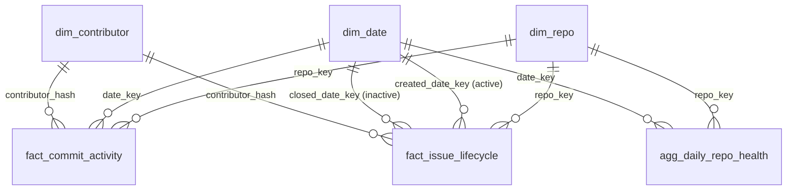

# RAG Ecosystem Activity Analytics: Medallion Pipeline (Final)

End-to-end PySpark pipeline on Databricks. It pulls GitHub activity for five RAG-stack repositories, builds **Bronze** and **Silver** Delta tables, models a **Gold** star schema, and serves it to a **Power BI** dashboard.

**Author:** M. Yaseen (24L-2515), BDS-5B
**Course:** DS3004 Data Warehousing and Business Intelligence, Fall 2026

**Repos tracked:** langchain-ai/langchain, run-llama/llama_index, chroma-core/chroma, qdrant/qdrant, deepset-ai/haystack

---

## 1. Architecture

```
GitHub REST API
   |  01_ingest_raw           Source -> Raw       (cursor pagination, rate-limit handling)
   v
Landing files (JSON lines in a Unity Catalog volume)
   |  02_raw_to_bronze        Raw -> Bronze       (explicit schemas, quarantine)
   v
Bronze   bronze_commits, bronze_issues, bronze_quarantine
   |  03_bronze_to_silver     Bronze -> Silver    (cast, hash PII, dedupe, MERGE INTO)
   v
Silver   silver_commits, silver_issues, silver_issue_labels, silver_quarantine
   |  05_silver_to_gold       Silver -> Gold      (star schema, MERGE for facts)
   v
Gold     dim_repo, dim_date, dim_contributor,
         fact_commit_activity, fact_issue_lifecycle, agg_daily_repo_health
   |  Power BI (Databricks connector, Import mode)
   v
Dashboard: Repo Activity + Pipeline Audit

pipeline_execution_logs  <- one audit row per file/table at every layer
```

Everything lives in catalog `workspace`, schema `rag`. Raw files live under `/Volumes/workspace/rag/raw/landing/{load_type}/{endpoint}/{repo}/{ingest_date}/`.

## 2. Repository layout

| Path | What it is |
|---|---|
| `notebooks/00_config_and_helpers` | Widgets (parameters), schema and volume setup, audit table, `log_run()` helper |
| `notebooks/01_ingest_raw` | GitHub API to raw JSON files |
| `notebooks/02_raw_to_bronze` | Explicit `StructType` schemas, Raw to Bronze, quarantine |
| `notebooks/03_bronze_to_silver` | Casting, PII hashing, dedupe, `MERGE INTO` into Silver |
| `notebooks/05_silver_to_gold` | Gold dimensions, facts, aggregate and optimization |
| `notebooks/04_run_pipeline` | Runner: calls 01, 02, 03 and 05 in order |
| `dashboard/RAG_Dashboard.pbix` | Power BI file |
| `docs/` | Proposal and final architecture report (PDF) |
| `sample_data/` | Small sample JSON files from the proposal |

## 3. Requirements checklist

| Requirement | Where / how |
|---|---|
| Explicit schemas, no inference | `02_raw_to_bronze`, `StructType` / `StructField` |
| `load_timestamp` on every table | Bronze, Silver and Gold |
| Idempotency | Silver and Gold facts use `MERGE INTO`. Re-running inserts and updates 0 rows. |
| Parameterized backfills | Widgets for dates, load type, repos, ingest date, batch (section 8) |
| Schema drift | Bronze quarantine, `mergeSchema`, `_raw_json` keeps full original record |
| Audit logging at every layer | `pipeline_execution_logs`, including `Silver-to-Gold` and `Gold-Optimize` |
| Gold star schema | Section 5 |
| Gold refreshes automatically after Silver | `04_run_pipeline` calls `05_silver_to_gold` right after Silver |
| Read optimization | Liquid Clustering and `OPTIMIZE` on the large Gold tables |
| BI on Gold with a proper model | Power BI, one-to-many relationships (section 7) |

## 4. Bronze and Silver models

Primary keys are logical. Delta does not enforce them, and the `MERGE` keys keep them unique in Silver.

### 4.1 Bronze (append-only, partitioned by `_source_repo`, `_ingest_date`)

| Table | Logical key | Content |
|---|---|---|
| `bronze_commits` | `_source_repo`, `sha` | `sha`, `html_url`, `commit` struct (author/committer name, email, date as STRING; message; comment_count; verification), `author` / `committer` GitHub user structs, `parents` array |
| `bronze_issues` | `_source_repo`, `id` | `id`, `number`, `state`, `state_reason`, `title`, `body`, `html_url`, `user` struct, `labels` array, `assignee(s)`, `locked`, `comments`, `created_at` / `updated_at` / `closed_at` as STRING, `author_association`, `draft`, `pull_request` struct |
| `bronze_quarantine` | none | `endpoint`, `raw_record`, `reason`, `_source_file`, `load_timestamp`, `_batch_id` |

Metadata columns on both Bronze data tables: `_raw_json` (original line), `_source_file`, `load_timestamp`, `_source_repo`, `_ingest_date`, `_load_type`, `_batch_id`.

### 4.2 Silver

Every Silver table also has `_row_hash`, `load_timestamp` and `_batch_id`.

**`silver_commits`** (PK: `repo_name`, `sha`)
`sha` STRING, `repo_name` STRING, `author_ts` TIMESTAMP, `committer_ts` TIMESTAMP, `author_name` STRING, `author_login` STRING, `contributor_hash` STRING (SHA-256 of lower-cased email), `commit_message` STRING, `comment_count` INT, `parent_count` INT, `is_verified` BOOLEAN, `html_url` STRING, `event_date` DATE

**`silver_issues`** (PK: `repo_name`, `issue_id`)
`issue_id` BIGINT, `repo_name` STRING, `number` BIGINT, `state` STRING, `title` STRING, `body` STRING, `author_login` STRING, `author_hash` STRING (SHA-256 of lower-cased login), `is_pull_request` BOOLEAN, `is_merged` BOOLEAN, `comment_count` INT, `created_ts` / `updated_ts` / `closed_ts` TIMESTAMP, `author_association` STRING, `html_url` STRING, `event_date` DATE

**`silver_issue_labels`** (PK: `repo_name`, `issue_id`, `label_name`)
`issue_id` BIGINT, `repo_name` STRING, `label_id` BIGINT, `label_name` STRING, `label_color` STRING

**`silver_quarantine`**: `entity`, `record_key`, `repo_name`, `reason`, `load_timestamp`, `_batch_id`

## 5. Gold data model (star schema)

Gold is not a copy of Silver. It is a dimensional model built for reporting: facts hold the measurable events, dimensions hold the descriptive attributes.

### 5.1 ER diagram



### 5.2 Dimensions

**`dim_repo`** (PK: `repo_key`), one row per repo
| Column | Type | Notes |
|---|---|---|
| repo_key | INT | surrogate key, 1 to 5 |
| repo_name | STRING | short name used in Silver (matches `silver_*.repo_name`) |
| owner | STRING | GitHub owner |
| full_name | STRING | `owner/repo` |
| stack_layer | STRING | orchestration, indexing, vector-db or framework |
| load_timestamp | TIMESTAMP | |

**`dim_date`** (PK: `date_key`), one row per day from the first to the last date in Silver
| Column | Type | Notes |
|---|---|---|
| date_key | INT | `yyyyMMdd` |
| full_date | DATE | |
| day_of_week, day_name | INT, STRING | |
| week_of_year, month_no, month_name, year_month, quarter, year | | `year_month` is `yyyy-MM` |
| is_weekend | BOOLEAN | |
| load_timestamp | TIMESTAMP | |

**`dim_contributor`** (PK: `contributor_hash`), one row per contributor, **no login and no name**
| Column | Type | Notes |
|---|---|---|
| contributor_hash | STRING | SHA-256 of the GitHub login when available, otherwise the commit email hash, otherwise `unknown` |
| first_contribution_date | DATE | earliest commit or issue/PR |
| total_commits | BIGINT | |
| total_issues_and_prs_opened | BIGINT | |
| repos_contributed_to | BIGINT | distinct repos across commits and issues/PRs |
| is_cross_repo | BOOLEAN | true when `repos_contributed_to` is 2 or more |
| load_timestamp | TIMESTAMP | |

### 5.3 Facts

**`fact_commit_activity`**: grain is one row per commit (PK: `repo_key`, `sha`)
| Column | Type | Notes |
|---|---|---|
| repo_key | INT | FK to `dim_repo` |
| sha | STRING | degenerate dimension |
| date_key | INT | FK to `dim_date` (commit date) |
| contributor_hash | STRING | FK to `dim_contributor` |
| commit_count | INT | always 1, so it can be summed |
| is_merge_commit | BOOLEAN | more than one parent |
| is_verified | BOOLEAN | |
| comment_count | INT | |
| message_length | INT | |
| author_ts | TIMESTAMP | |
| _silver_load_ts | TIMESTAMP | Silver `load_timestamp` of this row, used as the incremental watermark |
| load_timestamp | TIMESTAMP | |

**`fact_issue_lifecycle`**: grain is one row per issue or PR (PK: `repo_key`, `issue_id`)
| Column | Type | Notes |
|---|---|---|
| repo_key | INT | FK to `dim_repo` |
| issue_id | BIGINT | |
| number | BIGINT | |
| created_date_key | INT | FK to `dim_date` (active relationship) |
| closed_date_key | INT | FK to `dim_date` (inactive relationship), null while open |
| contributor_hash | STRING | FK to `dim_contributor` (hash of the login) |
| is_pull_request, is_merged, is_closed | BOOLEAN | |
| time_to_close_hrs | DOUBLE | hours from `created_ts` to `closed_ts`, null while open |
| comment_count | INT | |
| state | STRING | |
| created_ts, closed_ts | TIMESTAMP | |
| _silver_load_ts, load_timestamp | TIMESTAMP | |

**`agg_daily_repo_health`**: grain is repo by day (PK: `repo_key`, `date_key`)
| Column | Type | Notes |
|---|---|---|
| repo_key, date_key | INT | FKs to `dim_repo`, `dim_date` |
| commits | BIGINT | |
| active_contributors | BIGINT | distinct contributors that day |
| issues_opened, prs_opened | BIGINT | |
| items_closed | BIGINT | issues and PRs closed that day |
| load_timestamp | TIMESTAMP | |

### 5.4 Load strategy

| Table | Strategy | Why |
|---|---|---|
| `dim_repo`, `dim_date` | overwrite | tiny, static or generated |
| `dim_contributor` | overwrite | derived statistics, rebuilt from Silver |
| `fact_commit_activity`, `fact_issue_lifecycle` | `MERGE INTO` on the PK, only for Silver rows newer than the stored `_silver_load_ts` watermark | idempotent and incremental. Issues change state, so they must be updated, not just inserted. |
| `agg_daily_repo_health` | overwrite, rebuilt from the Gold facts | always consistent with the facts |

`gold_mode = full` ignores the watermark and reprocesses all of Silver.

### 5.5 Differences from the proposal
- `lines_added`, `lines_deleted` and `files_changed` are **not** in the commit fact. The GitHub commit list endpoint does not return them, and fetching them needs one extra API call per commit. The fact uses `commit_count`, `is_merge_commit`, `is_verified`, `comment_count` and `message_length` instead.
- `silver_contributors` and `silver_pull_requests` were not built as tables. Pull requests are identified in `silver_issues` by `is_pull_request` and `is_merged`, and contributor statistics live in `dim_contributor`.

### 5.6 PII
- Commit emails are hashed (SHA-256) in Silver and never leave it.
- `author_name` and `author_login` exist only in Silver. **Gold and Power BI contain no login, no name and no email**, only hashes.
- A hash is pseudonymous, not fully anonymous: anyone who already knows a login could hash it and look for a match.

## 6. Performance optimization (Gold)

After the load, `05_silver_to_gold` runs:

```sql
ALTER TABLE fact_commit_activity  CLUSTER BY (repo_key, date_key);
ALTER TABLE fact_issue_lifecycle  CLUSTER BY (repo_key, created_date_key);
ALTER TABLE agg_daily_repo_health CLUSTER BY (repo_key, date_key);
OPTIMIZE <each table>;
```

These are the columns every dashboard visual filters or groups by (repo and date). Each optimize step is written to the audit table as layer `Gold-Optimize`.

## 7. Power BI

**File:** `dashboard/RAG_Dashboard.pbix`. Connected to the Databricks SQL warehouse (server hostname and HTTP path, access token, Import mode). The token is entered in Power BI's login box only and is not stored in this repo.

**Model relationships** (all many-to-one, single direction):

| From (fact) | To (dimension) | Active |
|---|---|---|
| `fact_commit_activity[repo_key]` | `dim_repo[repo_key]` | yes |
| `fact_commit_activity[date_key]` | `dim_date[date_key]` | yes |
| `fact_commit_activity[contributor_hash]` | `dim_contributor[contributor_hash]` | yes |
| `fact_issue_lifecycle[repo_key]` | `dim_repo[repo_key]` | yes |
| `fact_issue_lifecycle[created_date_key]` | `dim_date[date_key]` | yes |
| `fact_issue_lifecycle[closed_date_key]` | `dim_date[date_key]` | **no** (Power BI allows one active path) |
| `fact_issue_lifecycle[contributor_hash]` | `dim_contributor[contributor_hash]` | yes |
| `agg_daily_repo_health[repo_key]` | `dim_repo[repo_key]` | yes |
| `agg_daily_repo_health[date_key]` | `dim_date[date_key]` | yes |

The three log tables (`pipeline_execution_logs`, `bronze_quarantine`, `silver_quarantine`) are loaded but deliberately not related to the star. `dim_date` is marked as the date table.

**Measures:** `Total Commits`, `Open Items`, `Median Close Hrs`, `Cross-Repo Contributors`, `Silver Quarantine Rows`, `Bronze Quarantine Rows`.

**Page 1, Repo Activity** (answers the Phase 1 questions)
- Line chart: commits per month by repo (momentum)
- Bar chart: median hours to close an issue by repo (triage speed)
- KPI cards: total commits, open items, median close hours
- Contributors active in 2 or more repos (shown with shortened hashes only)
- Slicer on `stack_layer`

**Page 2, Pipeline Audit**
- Runs by layer and status
- Rows written per layer
- Table of failed runs with error messages
- Quarantine row counts

Note: the first and last months in the data are partial (the pull started on 2024-10-10 and ends in late October 2026), so they look lower than the months in between.

## 8. Execution guide

### 8.1 One-time setup
1. Clone this repo into Databricks (Workspace, Create, Git folder).
2. Run `00_config_and_helpers` once. It creates schema `workspace.rag`, the volume and the audit table.
3. Create a GitHub token (read-only, public repos). Type it into the `github_token` widget when needed. **Never commit it, and clear the widget before committing a notebook.**

### 8.2 Widgets

| Widget | Used in | Meaning | Default |
|---|---|---|---|
| `load_type` | all | `full`, `incremental` or `backfill`. Names the landing folder, so 02 must match 01. | full |
| `start_date`, `end_date` | 01 | date window to pull | 2024-10-10 / 2026-10-10 |
| `repos` | 01 | comma-separated `owner/repo` list | the 5 repos |
| `endpoints` | 01 | `commits`, `issues` or both | commits,issues |
| `max_pages` | 01 | pages per repo and endpoint, `0` means all | 3 |
| `github_token` | 01 | API token | empty |
| `ingest_date` | 02, 03 | `*` for all, or one folder date | * |
| `force_reload` | 02 | `true` reloads files already in Bronze | false |
| `bronze_batch_id` | 03 | `*` or one Bronze batch | * |
| `gold_mode` | 05 | `incremental` (watermark) or `full` (reprocess all) | incremental |

### 8.3 Standard incremental load (all layers, including Gold)
Run `01_ingest_raw` directly (so the token is not stored in run history) with `load_type = incremental`, `start_date` about 3 days ago, `max_pages = 0`. Then run `04_run_pipeline` steps for Bronze, Silver and Gold, or the whole runner. Gold refreshes automatically at the end of the runner.

Check the result:
```sql
SELECT layer, parameter_or_file, status, rows_inserted, rows_updated, start_time, end_time
FROM workspace.rag.pipeline_execution_logs
WHERE load_type = 'incremental'
ORDER BY start_time DESC LIMIT 20;
```

### 8.4 Backfill
1. `01_ingest_raw` with `load_type = backfill`, the `start_date` / `end_date` window, and `repos` / `endpoints` narrowed if needed.
2. `02_raw_to_bronze` with the same `load_type`.
3. `03_bronze_to_silver` (use `ingest_date` or `bronze_batch_id` to limit it).
4. `05_silver_to_gold` with `gold_mode = incremental`, or `full` to rebuild Gold from Silver.

To rebuild Gold without touching GitHub, Bronze or Silver, run only `05_silver_to_gold` with `gold_mode = full`.

### 8.5 Proving idempotency
Run any layer twice with the same parameters. The second run logs `rows_inserted = 0` and `rows_updated = 0` for Silver, and `merge, nothing new` for both Gold facts. Dimensions and the aggregate are rebuilt by design.

## 9. Audit table: `pipeline_execution_logs`

| Column | Meaning |
|---|---|
| run_id, batch_id | unique id of the row and of the whole run |
| layer | `Source-to-Raw`, `Raw-to-Bronze`, `Bronze-to-Silver`, `Silver-to-Gold`, `Gold-Optimize` |
| load_type | full, incremental or backfill |
| parameter_or_file | repo and endpoint, path pattern, or target table with parameters |
| start_time, end_time | execution time of the step |
| status | Success or Failure |
| rows_inserted, rows_updated | rows written (MERGE metrics for Silver and Gold facts, row count for overwrites) |
| error_message | filled on failure |

## 10. Data volume

| Table | Unique rows | Unique raw JSON (MB) |
|---|---|---|
| bronze_commits | [fill in] | [fill in] |
| bronze_issues | [fill in] | [fill in] |
| **Total** | | **[fill in] MB** |

Window pulled: [start date] to [end date], all 5 repos.

## 11. Known limits

- GitHub allows 5,000 authenticated requests per hour. `01_ingest_raw` sleeps and retries when the limit is hit.
- The issues endpoint rejects `?page=N` on large repos, so ingestion follows GitHub's `next` links.
- For issues, GitHub's `since` parameter means "updated since" and there is no upper date limit, so a backfill of issues may pull records outside the window. The `MERGE` keys absorb the overlap.
- Commits without a linked GitHub login use the email hash, which cannot be matched to issue authors. A few people may therefore appear as two contributors.
- Free serverless compute allows one notebook run at a time, so the notebooks run one after another.
- Repeated pulls of the same window create extra raw files and Bronze duplicates. Silver and Gold stay correct because of the `MERGE` keys.
- Free Edition does not bill in dollars. The cost figures in the final report are estimates from stated assumptions.

## 12. Final report

The architecture and FinOps report is in `docs/` (PDF). It contains the architecture diagram, decision log (partitioning, schema drift, PII), Spark DAG analysis of the Gold aggregation, and the cost evaluation.
